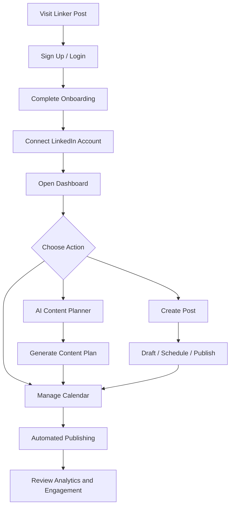
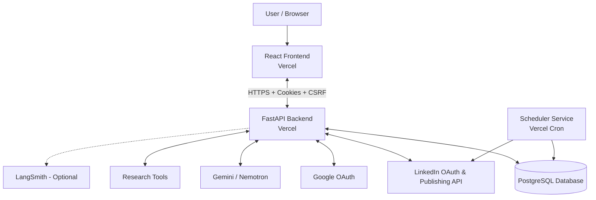
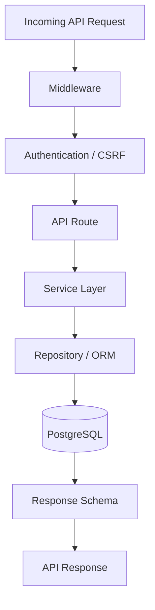
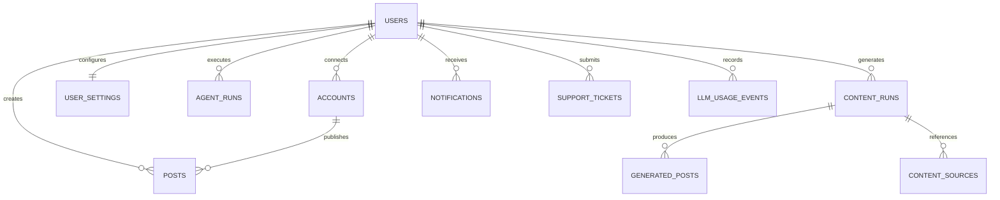
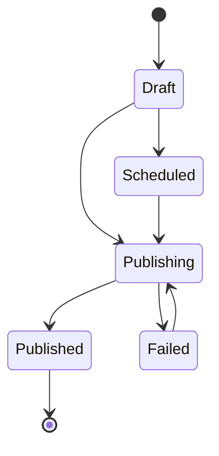
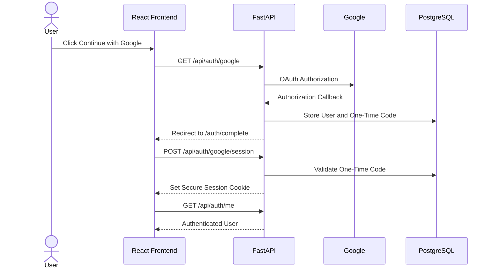
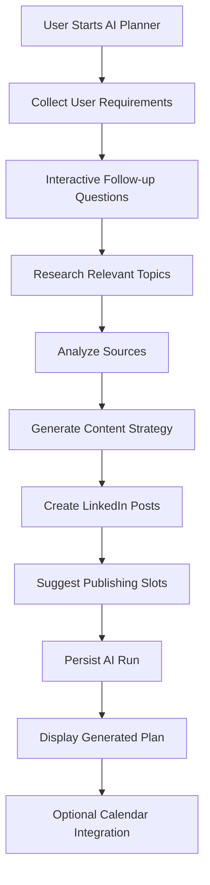
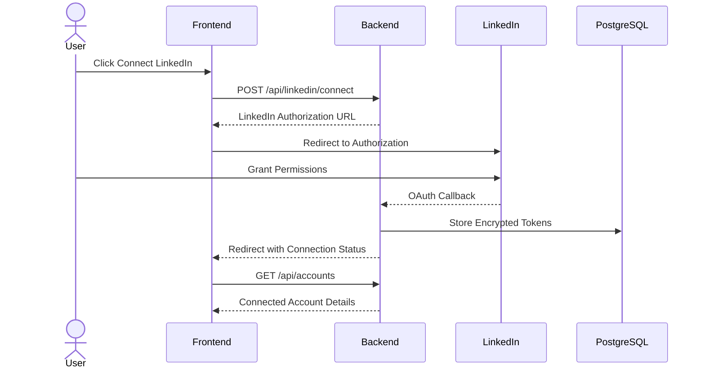
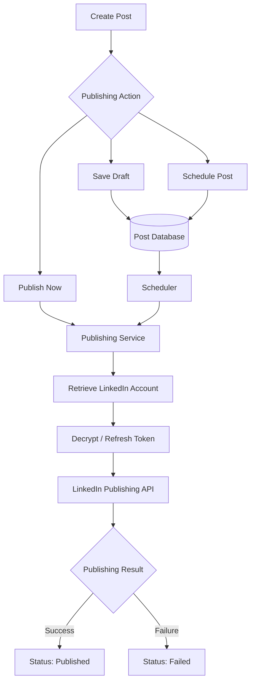
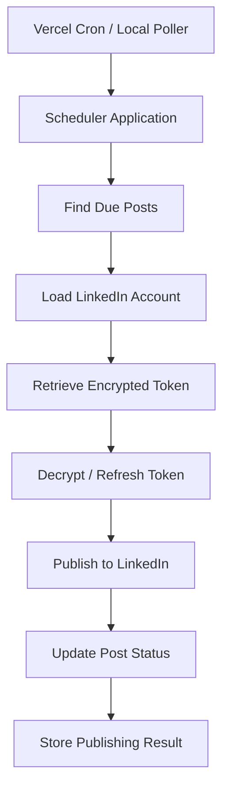

# Linker Post 🚀
### LinkedIn Content Management & AI-Powered Publishing Platform

[](https://linkerpost.vercel.app)
[](https://linkerpost-api.vercel.app)
[](https://www.postgresql.org/)
[](https://vercel.com/)

**Linker Post** is a LinkedIn-first content operations platform that helps creators, founders, and agencies manage their LinkedIn presence from a single workspace.

It combines content creation, AI-powered planning, post scheduling, automated publishing, calendar management, and engagement tracking into one centralized application.

**Live Application:** https://linkerpost.vercel.app  
**Backend API:** https://linkerpost-api.vercel.app

---

## 📌 Table of Contents

1. [Project Overview](#-project-overview)
2. [Business Objectives](#-business-objectives)
3. [Key Features](#-key-features)
4. [Technology Stack](#-technology-stack)
5. [System Architecture](#-system-architecture)
6. [Frontend Architecture](#-frontend-architecture)
7. [Backend Architecture](#-backend-architecture)
8. [Database Architecture](#-database-architecture)
9. [Authentication & Security](#-authentication--security)
10. [AI & Intelligent Agents](#-ai--intelligent-agents)
11. [LinkedIn Integration](#-linkedin-integration)
12. [Post Scheduling & Publishing](#-post-scheduling--publishing)
13. [API Documentation](#-api-documentation)
14. [End-to-End User Workflows](#-end-to-end-user-workflows)
15. [Third-Party Integrations](#-third-party-integrations)
16. [Background Processing](#-background-processing)
17. [Deployment & Infrastructure](#-deployment--infrastructure)
18. [Project Structure](#-project-structure)
19. [Implemented vs. Partial Features](#-implemented-vs-partial-features)
20. [Technical Considerations](#-technical-considerations)
21. [Future Improvements](#-future-improvements)

---

## 1. 🎯 Project Overview

Linker Post addresses a common problem faced by LinkedIn creators and businesses: maintaining a consistent and engaging content presence requires significant time and effort.

Users often manage multiple activities independently:

- Creating and editing LinkedIn posts.
- Finding relevant content ideas.
- Planning publishing schedules.
- Managing multiple LinkedIn accounts.
- Tracking published content and engagement.
- Maintaining a consistent posting strategy.

Linker Post brings these activities together into a unified content management workspace.

### Who Uses Linker Post?

| User Type | Purpose |
|---|---|
| Content Creators | Create and maintain consistent LinkedIn content |
| Founders | Manage personal branding and professional updates |
| Agencies | Manage content operations across multiple profiles |
| HR / Recruiters | Partial recruiting interface available |

### Core User Journey



---

## 2. 💡 Business Objectives

The platform focuses on three primary objectives:

**1. Content Consistency**
- Simplify content creation and scheduling.
- Help users maintain a regular publishing routine.
- Centralize content management.

**2. Operational Efficiency**
- Reduce manual publishing activities.
- Manage multiple LinkedIn profiles from one workspace.
- Automate scheduled publishing.

**3. AI-Assisted Content Strategy**
- Research relevant topics.
- Generate structured content plans.
- Rewrite and improve existing drafts.
- Suggest publishing schedules.

### Business Value

Linker Post helps users save time, improve content consistency, and streamline LinkedIn content operations through automation and AI assistance.

---

## 3. ✨ Key Features

The application has 21 major implemented feature areas and 4 partially implemented product surfaces.

### Authentication & Account Management
- Email-based registration and login.
- Google OAuth authentication.
- Secure cookie-based sessions.
- Logout and session invalidation.

### LinkedIn & Content Management
- Connect and disconnect LinkedIn accounts.
- Rich-text post composer.
- Image and video uploads.
- Save posts as drafts.
- Schedule posts for future publishing.
- Publish posts immediately.
- Add first comments during publishing.
- Synchronize LinkedIn post history.
- View post analytics.
- View and respond to comments.

### AI-Powered Capabilities
- AI Content Planner.
- AI-assisted content research.
- Multi-post content plan generation.
- Schedule generated content to the calendar.
- AI post rewriting.
- In-app Smart Assistant.

### Workspace Management
- Dashboard and usage statistics.
- Calendar management.
- In-app notifications.
- User settings and preferences.
- Support ticket submission.

---

## 4. 🛠 Technology Stack

### Frontend

| Technology | Purpose |
|---|---|
| React 19 | Component-based user interface |
| Vite 8 | Development server and build tooling |
| TanStack Router / Start | Routing and application rendering |
| TanStack Query | Server-state management |
| Tailwind CSS v4 | Utility-first styling |
| shadcn/ui | Reusable UI components |
| Radix UI | Accessible UI primitives |
| Quill | Rich-text post editor |
| React Hook Form | Form management |
| Zod | Input validation |
| Lucide | Icons |
| date-fns | Date manipulation |
| react-day-picker | Calendar and date selection |
| react-dropzone | Media uploads |
| Recharts | Data visualization |

### Backend

| Technology | Purpose |
|---|---|
| Python | Backend programming language |
| FastAPI | REST API framework |
| Uvicorn | ASGI application server |
| SQLAlchemy Async | Database ORM |
| asyncpg | PostgreSQL asynchronous driver |
| Alembic | Database migrations |
| Pydantic | Data validation |
| pydantic-settings | Environment configuration |
| HTTPX | External API communication |
| PyJWT | JWT authentication |
| Argon2 | Password hashing |
| Cryptography / Fernet | LinkedIn token encryption |
| python-multipart | Multipart file uploads |

### Database

- PostgreSQL
- SQLAlchemy asynchronous ORM
- Alembic migrations

### AI & LLM

| Technology | Purpose |
|---|---|
| LangGraph | AI agent workflow orchestration |
| LangChain | LLM integration |
| Google Gemini | Primary AI provider |
| NVIDIA Nemotron | Optional alternative LLM provider |
| LangSmith | Optional AI tracing |
| DuckDuckGo Search | Research and information retrieval |
| BeautifulSoup | Web content extraction |
| Playwright | Optional browser-based research |

### Infrastructure & DevOps

- Vercel – Frontend and backend deployments.
- Vercel Cron – Scheduled publishing triggers.
- PostgreSQL hosting – Persistent application data.
- Git and GitHub – Version control.
- Pytest – Backend testing.
- Ruff / Mypy – Backend quality checks.
- ESLint / Prettier – Frontend code quality.

---

## 5. 🏗 System Architecture

Linker Post follows a three-part deployment architecture.

The frontend, API, and scheduler are deployed independently but share the same PostgreSQL database.

### Deployment Components

| Component | Deployment | Responsibility |
|---|---|---|
| Frontend | linkerpost.vercel.app | User interface |
| Backend API | linkerpost-api.vercel.app | Business logic and API operations |
| Scheduler | linkerpost-scheduler | Scheduled post publishing |
| Database | External PostgreSQL | Persistent data storage |

### High-Level Architecture



### Request Lifecycle

An authenticated API request generally follows this sequence:

1. Browser sends an HTTPS request.
2. CORS middleware validates the request origin.
3. Request ID middleware adds request tracking.
4. Authentication middleware validates the JWT cookie.
5. CSRF validation is performed for protected state-changing requests.
6. Current user dependency identifies the authenticated user.
7. Route delegates business logic to the service layer.
8. SQLAlchemy performs database operations.
9. Pydantic validates the response.
10. API returns the result to the frontend.

---

## 6. 🎨 Frontend Architecture

The frontend is developed using React 19 and TanStack Router/Start.

It provides the application interface, manages user interactions, and communicates with the FastAPI backend.

### Main Application Routes

| Route | Description |
|---|---|
| `/` | Marketing website |
| `/login` | User login |
| `/signup` | User registration |
| `/auth/complete` | Google authentication completion |
| `/onboarding` | Initial setup |
| `/help` | Help documentation |
| `/privacy-policy` | Privacy policy |
| `/terms-of-service` | Terms and conditions |
| `/pricing` | Pricing interface |
| `/app/dashboard` | Dashboard |
| `/app/accounts` | LinkedIn account management |
| `/app/manage-posts` | Post composer and management |
| `/app/calendar` | Publishing calendar |
| `/app/agents` | AI agents |
| `/app/library` | AI run library |
| `/app/settings` | User settings |
| `/app/support` | Support |
| `/app/recruiting*` | Partial HR/recruiting interface |
| `/forgot-password` | Mailto-based recovery interface |

### Core Components

- **AppShell:** Main authenticated application layout.
- **ComposerModal:** Post creation and editing interface.
- **AgentRunDetail:** AI agent execution details.
- **NotificationDrawer:** Notification management.
- **SmartAgent:** In-app AI assistant.
- **Site Chrome:** Shared marketing and application layout.
- **shadcn Components:** Reusable dialogs, buttons, forms, and UI primitives.

### State Management

| State Type | Implementation |
|---|---|
| Authentication | React Context |
| Server State | TanStack Query |
| API Communication | `lib/api.ts` |
| Route Protection | `lib/auth.tsx` |
| Local UI State | React state and localStorage |
| Forms | React Hook Form + Zod |

The API client uses credentialed requests to maintain the cross-domain cookie-based session.

---

## 7. ⚙ Backend Architecture

The backend uses FastAPI and follows a modular service-oriented structure.

The main responsibilities include authentication, LinkedIn integrations, content management, AI execution, notifications, and scheduled publishing.

### Backend Architecture Layers

| Layer | Responsibility |
|---|---|
| Routes | Define HTTP endpoints |
| Dependencies | Authentication and request dependencies |
| Services | Business logic |
| Repositories | Database access abstraction |
| Models | SQLAlchemy database models |
| Schemas | Pydantic request and response validation |
| Core | Configuration, security, and cookies |
| Middleware | Request processing |
| Agents | AI workflows |
| Scheduler | Background publishing |

### Important Services

**post_publisher.py**
- Shared publishing logic for API and scheduler.
- Retrieves stored LinkedIn credentials.
- Handles token refresh.
- Publishes scheduled content.
- Updates publishing status.

**linkedin.py / linkedin_publishing.py**
- LinkedIn OAuth.
- Account connection.
- Post publishing.
- Analytics and comments.

**google_oauth.py**
- Google authentication.
- OAuth callback processing.
- One-time session code generation.

**notifications.py**
- Creates in-app notifications.
- Manages notification-related operations.

### Backend Request Flow



---

## 8. 🗄 Database Architecture

Linker Post uses PostgreSQL as its primary relational database.

SQLAlchemy Async provides database interaction, while Alembic manages schema migrations.

### Important Database Tables

| Table | Responsibility |
|---|---|
| `users` | User accounts and authentication details |
| `accounts` | Connected LinkedIn accounts and encrypted tokens |
| `posts` | Draft, scheduled, and published posts |
| `oauth_states` | OAuth state validation and temporary codes |
| `agents` | AI agent catalog |
| `agent_runs` | AI execution history |
| `agent_user_settings` | User-specific agent settings |
| `content_runs` | Content planner execution records |
| `content_sources` | Research source information |
| `generated_posts` | AI-generated post content |
| `notifications` | In-app notifications |
| `user_settings` | User preferences |
| `support_tickets` | Support requests |
| `llm_usage_events` | AI token and cost tracking |

### Entity Relationships



### Important Relationships

- One user can connect multiple LinkedIn accounts.
- One user can create multiple posts.
- A post can belong to one LinkedIn account.
- A LinkedIn account can be associated with multiple posts.
- User settings maintain a one-to-one relationship with users.
- Content planner runs can produce multiple generated posts and research sources.

### Database Indexing

Important indexes include:

- Unique email and Google ID.
- LinkedIn account uniqueness constraints.
- `posts.scheduled_for` for scheduled publishing queries.
- OAuth indexes on provider and state hash.

### Post Lifecycle



After successful publishing, uploaded media bytes are cleared from the post record according to the implemented publishing lifecycle.

---

## 9. 🔐 Authentication & Security

Security is an important part of the application, especially because LinkedIn publishing requires access to external account credentials.

### Authentication Methods

**Email Authentication**
- Users register using email and password.
- Passwords are hashed using Argon2.
- Login generates a signed JWT session.
- JWT is stored in an HttpOnly cookie.

**Google OAuth**
- Frontend redirects users to Google authentication.
- Google redirects to the backend callback.
- Backend generates a one-time session code.
- Frontend receives the code through `/auth/complete`.
- Frontend exchanges it through `/api/auth/google/session`.
- Backend sets the authenticated cookie.

**Logout**
- Increments the user's `token_version`.
- Invalidates the existing session.
- Clears authentication cookies.

### Authentication Flow



### Security Mechanisms

| Mechanism | Purpose |
|---|---|
| HttpOnly Cookies | Prevent JavaScript access to session tokens |
| JWT | Secure session authentication |
| CSRF Double-Submit | Protect state-changing requests |
| SameSite=None + Secure | Support cross-site cookie authentication |
| Partitioned Cookies | Support cross-site cookie isolation |
| Argon2 | Password hashing |
| Fernet Encryption | Encrypt LinkedIn tokens at rest |
| CORS Allowlist | Restrict permitted frontend origins |
| TrustedHost | Validate allowed host headers |
| HTTPS Redirect | Enforce secure transport |
| Security Headers | Reduce browser-based security risks |
| OAuth State Hash + TTL | Protect OAuth flows against CSRF and replay |
| Pydantic Validation | Validate incoming API data |

### Security Considerations

Some areas require additional attention:

- Application-level rate limiting is not implemented in the reviewed code.
- Password reset is not backed by a complete recovery API.
- Email verification is limited.
- Full role-based access control is not implemented.
- JWT and encryption secret rotation requires operational discipline.

---

## 10. 🤖 AI & Intelligent Agents

Linker Post integrates AI capabilities to simplify content research, generation, and editing.

### AI Technology

- LangGraph for workflow orchestration.
- LangChain for model integration.
- Google Gemini as the primary LLM.
- NVIDIA Nemotron as an optional provider.
- LangSmith for optional tracing.
- DuckDuckGo and configured search APIs for research.
- BeautifulSoup and optional Playwright for content extraction.

### AI Content Planner

The Content Planner is the primary executable AI agent.

Its responsibilities include:

1. Understanding user content requirements.
2. Asking follow-up questions when necessary.
3. Researching relevant topics.
4. Developing a content strategy.
5. Generating multiple LinkedIn posts.
6. Suggesting suitable publishing dates and times.
7. Preparing structured content plans.
8. Persisting generated content and research information.

### AI Workflow



### Other AI Capabilities

| Feature | Description |
|---|---|
| Content Planner | Research and generate structured content plans |
| AI Rewrite | Improve existing LinkedIn post drafts |
| Smart Assistant | In-app assistant for help and navigation |
| Usage Tracking | Record LLM token and cost information |
| AI Run Library | Review previous agent executions |

### AI Execution Considerations

- Agent execution currently uses synchronous HTTP requests.
- Client-facing SSE streaming is not implemented.
- Vercel execution limits must be considered for long-running requests.
- Only `ai_content_planner` is registered as an executable agent.
- Custom agent database records without registered runners cannot execute successfully.
- Agent cadence settings are stored but are not automatically executed by a background worker.

---

## 11. 🔗 LinkedIn Integration

LinkedIn integration is one of the platform's core capabilities.

It enables users to authorize LinkedIn accounts and publish content through LinkedIn's APIs.

### Account Connection Workflow



### LinkedIn Capabilities

- OAuth-based account connection.
- Account disconnection.
- Secure token storage.
- Token refresh where supported.
- Post publishing.
- LinkedIn post history synchronization.
- Post analytics.
- Comment retrieval.
- Comment and reply operations.

**Important:** The reviewed implementation primarily supports person-profile publishing. Organization/company pages are not first-class publishing targets.

---

## 12. 📅 Post Scheduling & Publishing

Users can create posts and choose how and when they want them published.

### Available Actions

| Action | Description |
|---|---|
| Save Draft | Store content without publishing |
| Schedule | Publish at a selected future time |
| Publish Now | Immediately initiate publishing |
| Edit | Update existing post content |
| Delete | Remove a post |
| Analytics | Review engagement information |
| Comments | View and respond to comments |

### Publishing Workflow



### Important Implementation Detail

The same `post_publisher.py` service is shared between API-triggered publishing and scheduler-triggered publishing.

This avoids maintaining two independent publishing implementations.

The scheduler does not require an active user browser session. It retrieves scheduled posts and uses the stored LinkedIn account credentials to publish them.

---

## 13. 🔌 API Documentation

The backend exposes REST endpoints under the `/api` prefix.

### Authentication APIs

| Method | Endpoint | Purpose |
|---|---|---|
| GET | `/api/auth/csrf` | Retrieve CSRF token |
| POST | `/api/auth/signup` | Register user |
| POST | `/api/auth/login` | Authenticate user |
| GET | `/api/auth/google` | Start Google OAuth |
| GET | `/api/auth/google/callback` | Google OAuth callback |
| POST | `/api/auth/google/session` | Exchange one-time session code |
| GET | `/api/auth/me` | Retrieve current user |
| POST | `/api/auth/logout` | Logout |

### LinkedIn & Account APIs

| Method | Endpoint | Purpose |
|---|---|---|
| POST | `/api/linkedin/connect` | Start LinkedIn OAuth |
| GET | `/api/linkedin/callback` | Handle LinkedIn callback |
| GET | `/api/accounts` | Retrieve connected accounts |
| DELETE | `/api/accounts/{id}` | Disconnect account |

### Post Management APIs

| Method | Endpoint | Purpose |
|---|---|---|
| GET | `/api/posts` | Retrieve posts |
| POST | `/api/posts` | Create draft, schedule, or publish |
| PATCH | `/api/posts/{id}` | Update post |
| DELETE | `/api/posts/{id}` | Delete post |
| POST | `/api/posts/{id}/publish` | Publish immediately |
| GET | Post analytics endpoint | Retrieve engagement analytics |
| GET | Post comments endpoint | Retrieve comments |
| POST | Post comments endpoint | Add comment or reply |
| POST | `/api/posts/rewrite-ai` | Rewrite content with AI |

### AI & Workspace APIs

| Method | Endpoint | Purpose |
|---|---|---|
| GET/POST/PATCH/DELETE | `/api/agents...` | Manage agents |
| POST | `/api/agents/{id}/run` | Execute an agent |
| GET | Agent runs endpoints | Retrieve execution history |
| GET | Library endpoints | Retrieve generated content |
| POST | Calendar endpoints | Materialize planner output |
| POST | `/api/assistant/chat` | Smart Assistant |
| GET/POST | `/api/notifications...` | Notifications |
| GET/PATCH | `/api/settings...` | User settings |
| POST | `/api/settings/support` | Submit support ticket |
| GET | `/api/usage/llm` | Retrieve LLM usage |
| GET | `/api/config` | Application configuration |
| GET | `/api/health/...` | Health checks |

### Scheduler APIs

| Method | Endpoint | Purpose |
|---|---|---|
| GET/POST | `/api/cron/publish-due` | Trigger due-post publishing |
| POST | `/run-once` | Manually execute scheduler |

Scheduler endpoints are protected using `CRON_SECRET`.

**Authentication Note:** Protected endpoints use the session cookie. Mutating operations generally require CSRF validation, while public OAuth callbacks and specifically designed scheduler endpoints use their respective security mechanisms.

---

## 14. 🔄 End-to-End User Workflows

### A. User Registration & Login

1. User visits the marketing website.
2. Selects email signup or Google login.
3. Backend validates credentials or OAuth response.
4. User session is created.
5. Secure cookie is issued.
6. Frontend verifies the session.
7. User is redirected to the dashboard.

### B. LinkedIn Account Connection

1. User opens the Accounts section.
2. Selects Connect LinkedIn.
3. Backend generates an authorization URL.
4. User grants permissions on LinkedIn.
5. LinkedIn redirects to the backend callback.
6. Backend securely stores encrypted credentials.
7. Frontend displays the connected account.

### C. Post Creation & Scheduling

1. User opens Manage Posts.
2. Writes content using the rich-text composer.
3. Adds media if required.
4. Chooses draft, schedule, or publish now.
5. Backend validates and stores the post.
6. Scheduler processes scheduled posts.
7. LinkedIn receives the publishing request.
8. Post status is updated.
9. User reviews publishing results and analytics.

### D. AI Content Planning

1. User opens AI Content Planner.
2. Provides content preferences.
3. AI collects additional requirements.
4. Research tools gather relevant information.
5. LangGraph orchestrates content generation.
6. Generated posts and schedule suggestions are saved.
7. User reviews the output.
8. Selected content can be added to the calendar.

---

## 15. 🌐 Third-Party Integrations

| Integration | Purpose | Failure Handling |
|---|---|---|
| Google OAuth | User authentication | Redirect to login on failure |
| LinkedIn OAuth | Account authorization | Public connection error codes |
| LinkedIn API | Publishing and engagement | Publishing failure status |
| Google Gemini | AI content generation | Human-readable AI errors |
| NVIDIA Nemotron | Alternative AI provider | Provider-dependent errors |
| DuckDuckGo Search | Research | Reduced research results if unavailable |
| Google Custom Search | Optional content research | Fewer research sources |
| YouTube API | Optional research | Reduced research results |
| LangSmith | AI tracing | Optional integration |
| Vercel Cron | Scheduler execution | Authentication/configuration errors |

The reviewed implementation does not contain integrated Stripe billing, SendGrid email delivery, S3 media storage, or Slack services.

---

## 16. ⏱ Background Processing

Linker Post uses a separate scheduler service rather than a traditional task queue system.

### Current Implementation

- Standalone FastAPI scheduler application.
- Local polling mechanism.
- Vercel Cron integration.
- Shared publishing service.
- PostgreSQL-based scheduled-post retrieval.

### Scheduler Workflow



### Important Scheduling Limitation

The current Vercel scheduler configuration uses a daily cron expression:

`0 0 * * *`

This means the configured cron trigger runs daily at midnight UTC.

Consequently, near-real-time scheduled publishing requires a more frequent trigger or an always-on polling service.

The application does not currently use Celery, Redis, or a dedicated distributed task queue.

---

## 17. 🚀 Deployment & Infrastructure

The application is deployed using Vercel with independent frontend, API, and scheduler projects.

### Deployment Configuration

| Component | Configuration |
|---|---|
| Frontend | `linkerpost.vercel.app` |
| Backend API | `linkerpost-api.vercel.app` |
| Scheduler | `linkerpost-scheduler` |
| Database | External PostgreSQL |
| Vercel Region | `bom1` |
| Database Region | Bangalore (as configured) |

### Important Environment Variables

**Backend**

```env
DATABASE_URL=
JWT_SECRET_KEY=
COOKIE_SECURE=
COOKIE_SAMESITE=
LINKEDIN_CLIENT_ID=
LINKEDIN_CLIENT_SECRET=
LINKEDIN_REDIRECT_URI=
GOOGLE_CLIENT_ID=
GOOGLE_CLIENT_SECRET=
GOOGLE_REDIRECT_URI=
CRON_SECRET=
LLM_PROVIDER=
GEMINI_API_KEY=
NVIDIA_API_KEY=
LANGSMITH_API_KEY=
```

**Frontend**

```env
VITE_API_URL=
VITE_SUPPORT_EMAIL=
VITE_ENABLE_HR=
```

Only configure variables actually required by the selected deployment and enabled integrations.

**Security:** Production secrets must be configured in Vercel environment settings. Never commit `.env` or `.env.prod` files containing credentials.

### Deployment Process

1. Configure environment variables.
2. Verify database connectivity.
3. Apply Alembic migrations.
4. Build and test the frontend.
5. Deploy the frontend project.
6. Deploy the API project.
7. Deploy the scheduler project.
8. Verify health endpoints.
9. Test authentication and LinkedIn integration.
10. Verify scheduled publishing.

---

## 18. 📂 Project Structure

### Frontend

```text
fe/
├── src/
│   ├── routes/
│   │   ├── login/
│   │   ├── signup/
│   │   ├── app/
│   │   └── ...
│   ├── components/
│   │   ├── app/
│   │   └── ui/
│   ├── lib/
│   │   ├── api.ts
│   │   └── auth.tsx
│   ├── styles.css
│   └── ...
├── vite.config.ts
└── package.json
```

### Backend

```text
be/
├── main.py
├── api/
│   └── index.py
├── app/
│   ├── main.py
│   ├── api/
│   │   ├── routes/
│   │   └── dependencies.py
│   ├── core/
│   ├── db/
│   ├── models/
│   ├── schemas/
│   ├── services/
│   ├── middleware/
│   └── repositories/
├── agents/
├── scheduler/
├── migrations/
├── tests/
├── deploy.md
└── ...
```

### Important Directories

| Directory | Responsibility |
|---|---|
| `fe/src/routes` | Frontend route definitions |
| `fe/src/components` | Reusable UI components |
| `fe/src/lib` | API and authentication utilities |
| `be/app/api/routes` | API endpoint definitions |
| `be/app/services` | Business logic and integrations |
| `be/app/models` | Database models |
| `be/app/schemas` | Pydantic schemas |
| `be/app/repositories` | Database access abstractions |
| `be/agents` | AI agent implementation |
| `be/scheduler` | Background publishing |
| `be/migrations` | Database schema migrations |

Generated files and dependencies such as `node_modules`, `.vercel/output`, `__pycache__`, and generated route trees should not be treated as manually maintained source files.

---

## 19. 📊 Implemented vs. Partial Features

### Implemented Features

| Category | Features | Count |
|---|---|---:|
| Authentication | Email login/signup, Google OAuth, logout | 3 |
| Social & Content | LinkedIn accounts, composer, drafts, scheduling, publishing, first comment, calendar, history sync, analytics, comments | 9 |
| AI | Content Planner, calendar materialization, run library, AI rewrite, Smart Assistant | 5 |
| Workspace | Dashboard, notifications, settings, support | 4 |
| **Total** | | **21** |

### Partially Implemented Features

| Feature | Current Status |
|---|---|
| Pricing & Billing | Pricing interface exists; payment processing is not implemented |
| HR / Recruiting | Frontend interface shells only; no complete backend |
| Forgot Password | Mailto-based interface; no complete password reset API |
| Referral System | Referral code displayed; signup attribution not implemented |

These partial interfaces should not be represented as fully shipped product capabilities.

---

## 20. ⚠️ Technical Considerations & Maintenance Notes

The following are important considerations for developers maintaining or extending the platform.

### Authentication

- Cross-site cookie configuration must remain consistent.
- Google OAuth uses a one-time code exchange to establish the frontend session.
- LinkedIn OAuth callback cannot depend on the original browser cookie being available.
- Token versioning is used for session invalidation.
- There is no application refresh-token rotation for Linker Post sessions.

### Scheduler

- Current cron configuration is daily.
- Scheduler and API must use the same publishing service.
- LinkedIn token refresh must be handled before publishing.
- Failed publishing operations should retain their status for troubleshooting.

### AI

- Synchronous agent execution may reach Vercel execution limits.
- Agent cadence fields are not automatically processed.
- Custom agents require registered execution handlers.
- AI usage and cost controls need operational monitoring.

### Database & Storage

- PostgreSQL currently stores application data and post media.
- Storing media directly in PostgreSQL can become a scaling concern.
- Appropriate indexes are important for scheduled-post queries.
- Database migrations should be applied carefully during deployment.

### Product Scope

- HR/recruiting is not a complete backend feature.
- Pricing and billing are not fully implemented.
- Company-page publishing is not a first-class workflow.
- Referral attribution is not implemented.

---

## 21. 🔮 Future Improvements

Potential areas for future development include:

1. **More Frequent Scheduling:** Move toward minute-level or near-real-time publishing.
2. **Distributed Background Jobs:** Introduce a reliable queue-based architecture if publishing volume grows.
3. **Cloud Media Storage:** Move uploaded media to object storage.
4. **Password Recovery:** Implement secure email-based password reset.
5. **Email Verification:** Add complete email verification workflows.
6. **Role-Based Access Control:** Support agencies, teams, and workspace permissions.
7. **Billing Integration:** Introduce subscription management and payment processing.
8. **Organization Publishing:** Expand support for LinkedIn company pages.
9. **AI Streaming:** Introduce streaming responses for longer AI workflows.
10. **Monitoring:** Integrate centralized error tracking and application performance monitoring.
11. **Rate Limiting:** Add application-level API protection.
12. **Automated Agent Scheduling:** Implement recurring AI agent execution.

---

## 22. 📌 Final Summary

Linker Post is a LinkedIn-focused content management and AI automation platform designed to simplify professional content operations.

It provides an integrated workflow for:

- User registration and authentication.
- LinkedIn account management.
- Content creation and editing.
- Draft management and scheduled publishing.
- Automated background publishing.
- AI-powered content research and generation.
- Calendar management.
- Post analytics and engagement.
- Notifications and workspace settings.

### Architecture at a Glance

| Layer | Technology |
|---|---|
| Frontend | React 19, Vite, TanStack Router/Start |
| UI | Tailwind CSS, shadcn/ui, Radix |
| Backend | Python, FastAPI |
| Database | PostgreSQL |
| ORM | SQLAlchemy Async |
| Migrations | Alembic |
| Authentication | JWT, HttpOnly Cookies, Argon2 |
| Encryption | Fernet |
| AI | LangGraph, LangChain, Gemini |
| Integrations | Google OAuth, LinkedIn API |
| Deployment | Vercel |
| Background Jobs | FastAPI Scheduler, Vercel Cron |

**The core product journey:**

`Sign Up → Connect LinkedIn → Create Content → AI Assistance → Schedule → Automated Publishing → Analytics`

Linker Post brings content strategy, creation, scheduling, publishing, and performance management into one unified LinkedIn workspace.

---

**Project:** Linker Post  
**Frontend:** https://linkerpost.vercel.app  
**Backend:** https://linkerpost-api.vercel.app

*Documentation reflects the reviewed implementation and deployment configuration. Environment variables, endpoint details, and infrastructure settings should be verified against the current production configuration before operational changes.*
